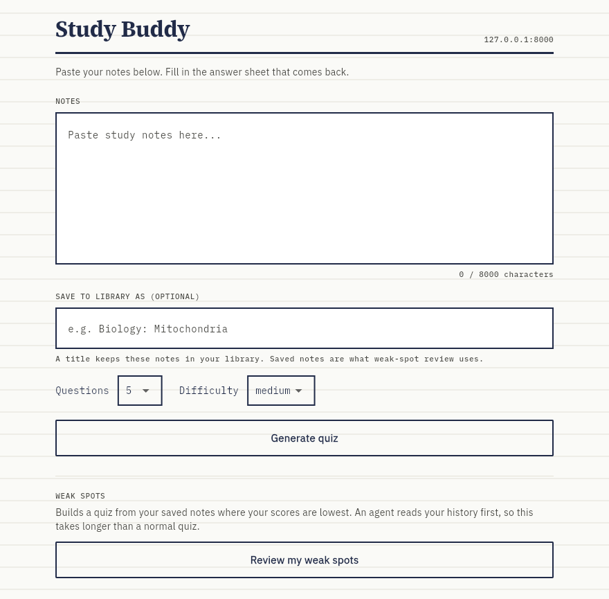
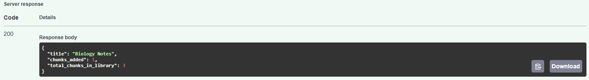
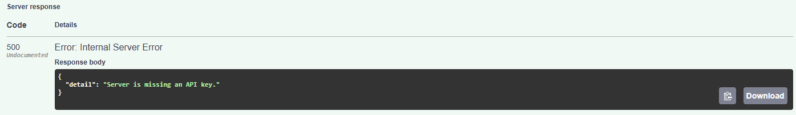

# AI Study Buddy

Paste study notes, get a multiple-choice quiz generated from them, and test
yourself. A Flutter app talking to a Python backend that calls the Claude API.

Live backend: [ai-study-buddy-lazv.onrender.com](https://ai-study-buddy-lazv.onrender.com)
(hosted on Render's free tier - the first request after a period of
inactivity can take 30-50 seconds to wake up)

The root URL itself returns a 404 - that's expected, there's nothing
defined there. To actually see it working, try:

- [/health](https://ai-study-buddy-lazv.onrender.com/health) - confirms the server is running
- [/docs](https://ai-study-buddy-lazv.onrender.com/docs) - interactive API docs where you can try every endpoint directly in the browser

## Screenshots

**Flutter app - home screen**



**Backend API - adding a note to the library**



**RAG retrieval - correctly finds relevant notes before calling the AI**



---

## Why I built this

Making practice questions from your own notes takes time. This automates
that step so studying starts faster.

## Architecture

```
Flutter app  --HTTP-->  FastAPI backend  --API call-->  Claude
```

The Flutter app never talks to Claude directly. It only calls the backend,
which holds the API key and does the actual generation. This keeps the key
off the client and makes it possible to add features later (auth, rate
limiting, saving quiz history) without touching the app.

The backend has two ways to build a quiz from the notes library:

- **Fixed pipeline** (`/generate-quiz-from-topic`): BM25 search, take the top
  chunks, one Claude call.
- **Agent** (`/agent/generate-quiz`): Claude is given tools and decides what to
  look up, how often, and when it has enough material. See
  [Agent mode](#agent-mode-a-quiz-built-by-a-tool-using-agent).

```
FastAPI backend  <--tool calls-->  Claude
   |  list_notes, search_notes, get_note, get_source_stats, submit_quiz
   v
notes library (BM25 over SQLite chunks)  +  quiz history (SQLite)
```

## Project structure

```
ai-study-buddy/
    backend/
        main.py           FastAPI app: quiz generation, notes library endpoints
        rag.py            chunking and BM25 retrieval for the notes library
        database.py       SQLite persistence for the notes library
        agent.py          tool-using quiz agent (Anthropic SDK tool use)
        agent_routes.py   the POST /agent/generate-quiz endpoint
        quality.py        verify questions against the notes, rewrite bad ones
        evaluate.py       retrieval and quiz-quality measurements
        eval_data/
            dataset.json      starter notes and queries for evaluate.py
        tests/            pytest suite (test_main.py, test_agent.py)
        requirements.txt
    frontend/
        lib/
            main.dart          app entry point, notes input screen
            quiz_screen.dart   quiz taking screen with scoring
            study_buddy_api.dart   HTTP client for the backend
            quiz_question.dart     data model
        pubspec.yaml
    frontend-web/
        index.html        standalone browser test page, no build step
    flutter-home.png
    backend-api.png
    rag-search.png
```

`evaluate.py` writes its results to `backend/eval_results/` (created on
first run).

## Running the backend

```bash
cd backend
pip install -r requirements.txt
export ANTHROPIC_API_KEY=sk-ant-your-key-here
uvicorn main:app --reload
```

On Windows PowerShell, set the key with
`$env:ANTHROPIC_API_KEY = "sk-ant-your-key-here"` instead of `export`, and
start the server with `python -m uvicorn main:app --reload`.

Runs at `http://127.0.0.1:8000`. Check it works:

```bash
curl http://127.0.0.1:8000/health
```

## Running the Flutter app

```bash
cd frontend
flutter pub get
flutter run -d chrome --dart-define=BACKEND_URL=http://127.0.0.1:8000
```

The `BACKEND_URL` define points the app at your running backend. Without
it, the app defaults to `http://127.0.0.1:8000`.

The Flutter app and the browser page use the fixed-pipeline endpoints. Agent
mode is available through the API (and `/docs`) only for now.

## Trying the browser test page (no Flutter needed)

`frontend-web/index.html` is a standalone page that talks to the same
backend, useful for testing or demoing without installing Flutter. It has
no dependencies and no build step.

1. Start the backend as described above, and leave it running.
2. Open `frontend-web/index.html` directly in a browser (double-click it,
   or drag it into a browser window).
3. Paste some notes and generate a quiz.

It expects the backend at `http://127.0.0.1:8000`. If you deploy the
backend elsewhere, change the `BACKEND_URL` constant near the top of the
`<script>` section in that file.

## Building a quiz from a topic (RAG)

Besides pasting notes directly, you can build up a library of notes over
time and generate a quiz on a specific topic, without needing to paste
everything into one request.

Add a document to the library:

```bash
curl -X POST http://127.0.0.1:8000/notes \
  -H "Content-Type: application/json" \
  -d '{"title": "Biology Chapter 1", "text": "Photosynthesis is..."}'
```

Add as many documents as you like this way. Then generate a quiz on a
topic instead of pasting notes:

```bash
curl -X POST http://127.0.0.1:8000/generate-quiz-from-topic \
  -H "Content-Type: application/json" \
  -d '{"topic": "mitochondria", "num_questions": 5, "difficulty": "medium"}'
```

`difficulty` is optional (`easy`, `medium`, or `hard`; defaults to
`medium`) and changes how the questions are written - `easy` sticks to
facts stated directly in the notes, `hard` requires connecting multiple
ideas rather than just recalling one.

The backend searches the library for the most relevant chunks using BM25
keyword search, sends only those chunks to Claude, and returns a quiz -
the same pattern used in the "RAG and Agentic Search" section of the
"Building with the Claude API" course. The library is stored in a local
SQLite file (`notes.db`, created automatically next to `main.py`), so it
survives server restarts.

## Agent mode: a quiz built by a tool-using agent

The fixed pipeline above always does the same thing: one search, top chunks,
one generation call. If the search words don't match the notes, it finds the
wrong material or nothing at all. In agent mode Claude gets tools and decides
the steps itself:

| Tool | What it does |
|---|---|
| `list_notes` | titles of all notes in the library, with chunk counts |
| `search_notes` | BM25 keyword search; the agent retries with different words if results are empty or off-topic |
| `get_note` | full text of one note |
| `get_source_stats` | the user's accuracy per note, weakest first (built on the window-function query below) |
| `submit_quiz` | the final quiz, checked for shape before it is accepted |

```bash
curl -X POST http://127.0.0.1:8000/agent/generate-quiz \
  -H "Content-Type: application/json" \
  -d '{"goal": "quiz me on how cells make energy", "num_questions": 5, "difficulty": "medium", "verify": true}'
```

`goal` is free text, for example `"quiz me on mitochondria"` or `"review my
weak spots"`. The response contains `quiz_id`, `questions` (same shape as the
other endpoints), `source` (the note the quiz is saved under in the history),
`trace` (every tool call the agent made, so you can see what it did) and
`quality` (see the next section). Errors: `400` if the library is empty, `404`
if the agent finds nothing relevant, `502` if it cannot produce a valid quiz.

Details worth knowing:

- The agent can only use text that the tools returned. A quiz submitted before
  any note was retrieved is rejected, and the model has to retrieve first.
- A submission with the wrong number of questions, or a question that is not
  well formed (not 4 distinct options, bad `correct_index`), is sent back to
  the model as a tool error so it can fix it and resubmit.
- The loop is capped at 8 steps.
- It is implemented with the Anthropic SDK's tool use directly, in
  `backend/agent.py`.

## Checking question quality (reflection)

LLM-written quizzes sometimes contain questions with two defensible answers,
a wrong answer marked as correct, or an answer that is not in the notes at
all. With `verify: true` (the default in agent mode), a second Claude call
reviews every question against the notes the agent actually retrieved and
checks three things: the answer can be found in the notes, exactly one option
is correct, and the marked option is the correct one.

Questions that fail are rewritten using the reviewer's reason and checked
again, for at most two rewrite rounds. Questions that still fail are dropped,
so a quiz can come back shorter than requested. The `quality` field reports
what happened:

- `requested`: how many questions went in
- `initial_passed`: how many passed on the first check
- `dropped`: how many were removed at the end
- `rounds`: per round, how many passed and why the others failed

Both calls use forced tool calls with a fixed schema, so the model's answer
does not have to be parsed out of free text. The model can be changed with
the `STUDY_BUDDY_MODEL` environment variable.

## Evaluation

`backend/evaluate.py` measures the pipelines on a fixed dataset
(`eval_data/dataset.json`: notes, plus queries with the note each one should
find). It runs against a temporary database, never the real `notes.db`.

```bash
cd backend
python evaluate.py retrieval          # offline, free, no API key
python evaluate.py quiz --limit 6     # real API calls, needs ANTHROPIC_API_KEY
```

### Retrieval (BM25, measured)

Run on the starter dataset: 6 notes and 12 queries. Half are keyword queries
(the same words as the note), half are paraphrases (different words).

| Queries | n | hit@1 | MRR |
|---|---|---|---|
| all | 12 | 58% | 0.76 |
| keyword | 6 | 100% | 1.00 |
| paraphrase | 6 | 17% | 0.53 |

BM25 finds the right note when the query shares its words and often ranks the
wrong note first when it does not. In this run the right note was still inside
the top 6 every time (hit@6 is 100%), but that is only because the library has
6 notes, so that number says little until the dataset is larger. The starter
dataset is small and was written for testing the setup, so treat these
numbers as a demonstration of the method, not a benchmark.

### Quiz quality (not measured yet)

`evaluate.py quiz` compares four configurations on the same queries: the fixed
pipeline, the fixed pipeline plus the quality check, the agent, and the agent
plus the quality check. For each it reports how often the right note was
retrieved, what share of returned questions pass an independent review against
the full text of the right note, how many valid questions come back per
quiz requested, and the cost in API calls, tokens and seconds.

| Configuration | Retrieval hit | Question pass rate | Valid questions / requested | API calls / quiz |
|---|---|---|---|---|
| fixed pipeline | not measured yet | not measured yet | not measured yet | not measured yet |
| fixed pipeline + quality check | not measured yet | not measured yet | not measured yet | not measured yet |
| agent + quality check | not measured yet | not measured yet | not measured yet | not measured yet |

This table gets filled in once the evaluation has been run with a real API
key. Two things to keep in mind when reading it: the reviewer is the same
prompt the quality check uses and, unless `STUDY_BUDDY_JUDGE_MODEL` points to
a different model, it runs on the same model that wrote the quiz; and the
agent costs more calls and time than the fixed pipeline, which is why those
columns are part of the comparison.

### Known limitation

For topic quizzes, the quiz history stores the source of the top-ranked chunk.
When that chunk comes from the wrong note (5 of the 12 queries above ranked a
wrong note first), the score is saved under the wrong note, which also skews
the accuracy stats. Agent mode records the sources the agent says it used, but
a quiz is still saved under a single source.

## Tracking accuracy over time (SQL window functions)

Every completed quiz is logged with its score. `GET /quiz-history/stats`
returns a running average accuracy per topic, computed directly in SQL
using a window function:

```sql
SELECT source, created_at, score, total,
    AVG(CAST(score AS FLOAT) / total) OVER (
        PARTITION BY source
        ORDER BY created_at
        ROWS BETWEEN UNBOUNDED PRECEDING AND CURRENT ROW
    ) AS running_avg_accuracy
FROM quiz_history
WHERE score IS NOT NULL
```

`PARTITION BY source` keeps each topic's average separate from the
others, and `ORDER BY created_at` makes the average "running" - each row
shows the average up to and including that point in time, not the
overall average. This is the same window function pattern covered in
Kaggle's "Advanced SQL" course.

The agent's `get_source_stats` tool reads this same query, so it can build a
quiz from the notes where the running average is lowest.

## Deploying the backend

1. Push this repo to GitHub.
2. Create a free account at render.com.
3. New Web Service, connect this repo, set the root directory to `backend`.
4. Build command: `pip install -r requirements.txt`. Start command: `uvicorn main:app --host 0.0.0.0 --port $PORT`.
5. Add an environment variable: `ANTHROPIC_API_KEY` with your real key.
6. Deploy. You get a public URL, something like `https://ai-study-buddy.onrender.com`.
7. Run the Flutter app with that URL: `flutter run -d chrome --dart-define=BACKEND_URL=https://ai-study-buddy.onrender.com`

## Testing status

Backend: fully tested by running the server and sending real requests.
Confirmed working: input validation (empty notes rejected, question count
capped at 10), missing API key handled cleanly, invalid API key handled
cleanly with no crash. The notes library and topic-based retrieval
(`/notes`, `/generate-quiz-from-topic`) were tested on two separate
machines. During that testing, a real bug was found and fixed: BM25
scoring returns negative/zero scores for terms that appear in a very
small library (a known edge case with tiny corpora), which caused valid
matches to be filtered out. The fix falls back to keyword-overlap
matching when no positive BM25 scores are found. After the fix: adding
documents, listing them, searching with a matching topic (correctly
reaches the AI call and stops cleanly without a key), and searching with
an unrelated topic (correctly returns a 404) all work as expected. The
success path (a valid key producing a real quiz, from either endpoint)
was not run, since that requires a real key - confirm that once yourself.

Agent mode and the quality check were tested without a real key: the agent
loop, the quality check and the `/agent/generate-quiz` endpoint run against a
scripted stand-in for the Claude client, which checks the logic (tool calls,
rejected submissions, retries, rewriting, dropping, error codes) but not how
the real model behaves. `evaluate.py retrieval` was run for real; the quiz
mode of `evaluate.py` was only checked end to end with the stand-in client.
The success path of agent mode against the real API has not been run yet.

Persistence was also verified directly: added a note, killed the server
process completely (not just `--reload`, an actual process kill), started
a fresh process, and confirmed the note was still there and searchable.
The library now survives restarts via a local SQLite file (`notes.db`).

Frontend: `flutter analyze` reports no issues. The app was run in Chrome
and confirmed to render correctly, including error handling when the
backend is unreachable, and the difficulty selector renders alongside
the question count selector as expected.

## Running the automated tests

The backend has a pytest suite covering the behavior described above,
so it can be re-checked with one command instead of manual curl requests:

```bash
cd backend
pip install -r requirements.txt
pytest tests/ -v
```

(If `pytest` is not recognized, for example in Windows PowerShell, use
`python -m pytest tests/ -v`.)

Each test runs against a temporary, isolated SQLite database (not the
real `notes.db`), so running the tests never affects real data. All 38
tests pass.

The first 13 cover the original behavior: input validation, missing/invalid
API key handling, adding and listing notes, topic search matching and not
matching, quiz score submission (including the not-found case), quiz history
retrieval, and the accuracy trend window-function query (verified against
hand-computed expected values).

The other 25 cover agent mode and the quality check, using a scripted
stand-in for the Claude client so they need no API key and cost nothing:
question validation, rewriting failed questions, dropping questions that
never pass, the agent using tools and submitting, rejecting malformed
submissions and letting the model retry, refusing a quiz submitted before any
note was retrieved, giving up in plain text, the step limit, the per-note
accuracy tool, and the endpoint's status codes.

## Possible extensions

- Support uploading a PDF or image of notes instead of pasting text
- Flashcard mode in addition to quiz mode
- Show past quiz results (score trends over time) in the app itself,
  using the quiz history data that's already collected
- Use agent mode from the Flutter app, including a "review my weak spots" button
- Add embeddings and hybrid search (BM25 plus dense) to handle paraphrased
  queries, and compare it against BM25 with the evaluation script
- Save a quiz under every note it used, not just one

## Tech stack

Flutter, Dart, Python, FastAPI, Anthropic SDK (including tool use), pytest, SQLite
